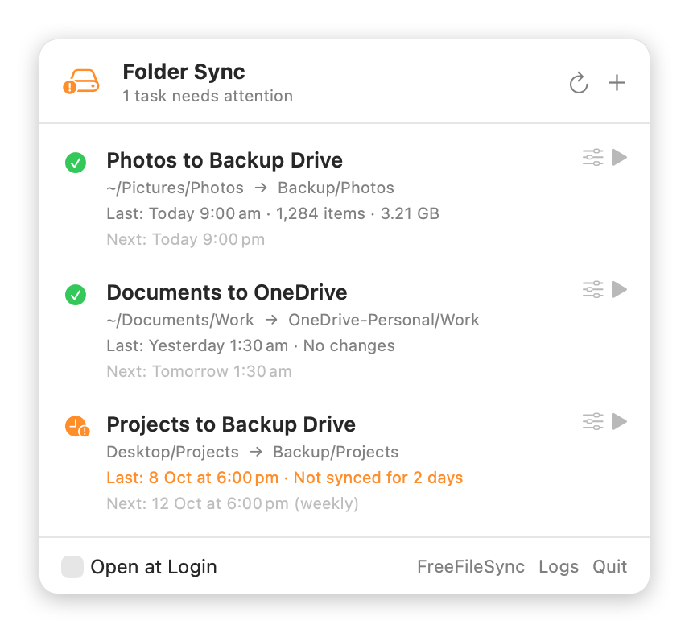
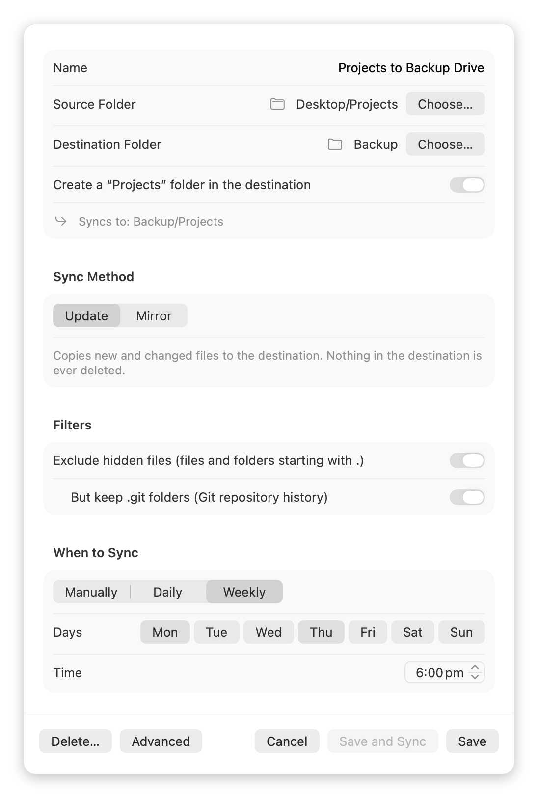
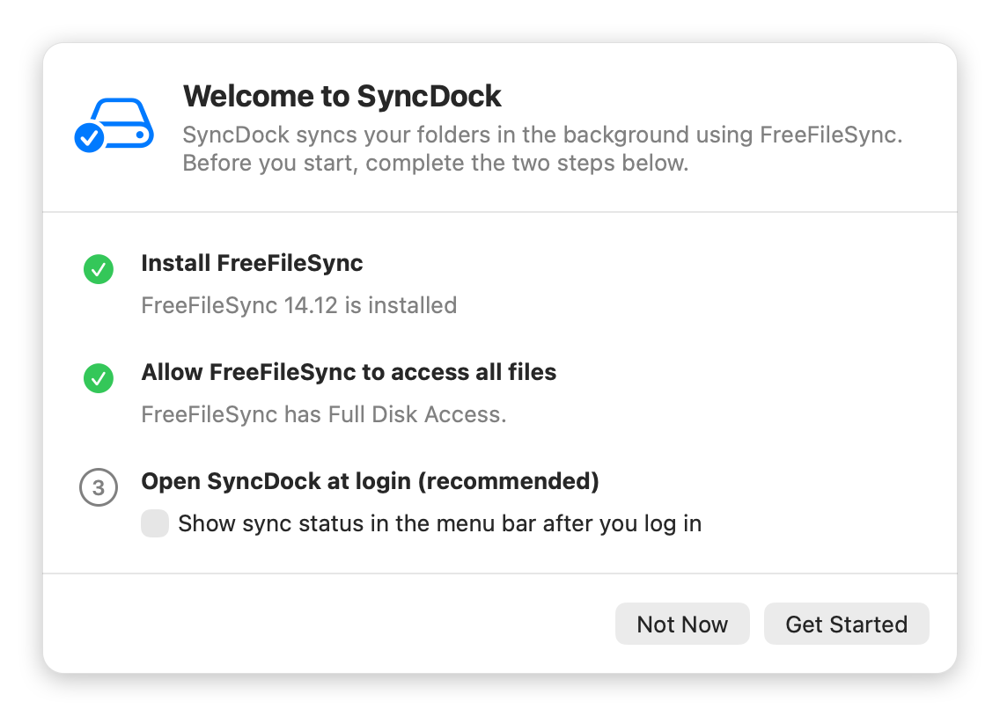

# SyncDock

[中文](README.zh-CN.md) | **English**

A macOS menu bar app for keeping folders in sync with a simple interface: pick a source and a destination folder, choose when to sync, and SyncDock takes care of the rest in the background.

The syncing itself is done by the free, open-source [FreeFileSync](https://freefilesync.org). SyncDock adds what FreeFileSync doesn't focus on: an easy interface, scheduled runs, and status at a glance.

<p align="center"></p>

> SyncDock is an independent project and is not affiliated with FreeFileSync.

## Download

**[⬇ Download SyncDock for macOS](https://github.com/yuting-ai/SyncDock/releases/latest/download/SyncDock.dmg)**

macOS 15 or later · Apple silicon and Intel · Notarized by Apple · Free and open source (MIT)

All versions and release notes: [Releases](https://github.com/yuting-ai/SyncDock/releases)

## Screenshots

<table>
  <tr>
    <th>Editing a task</th>
    <th>First-run setup</th>
  </tr>
  <tr>
    <td valign="top"></td>
    <td valign="top"></td>
  </tr>
</table>

## Features

- **Status in the menu bar**: each task's last result (how many items, how much data) and its next scheduled run.
- **Create and edit tasks**: choose a source and a destination folder. By default SyncDock creates a folder named after the source inside the destination, and shows exactly where files will go.
- **Two sync methods**
  - **Update**: copies new and changed files to the destination and never deletes anything there (default).
  - **Mirror**: makes the destination identical to the source; files deleted from the source are also deleted from the destination (moved to the Trash).
- **Filters**: exclude hidden files, optionally keeping `.git` folders (handy for backing up code).
- **Schedules**: manual, daily, or on chosen weekdays. Runs in the background with **no app needing to stay open**.
- **Sync Now**: run any task once, whenever you like.
- **External drive aware**: if the drive isn't connected, the sync is skipped with a notification, so nothing is written to your internal disk by mistake.
- **First-run setup**: checks that FreeFileSync is installed and has Full Disk Access, and walks you through each step.
- **Chinese and English interface**: follows your system language.

## Requirements

- macOS 15 or later (Apple silicon or Intel)
- [FreeFileSync](https://freefilesync.org/download.php) (free)

## Installation

1. [Download SyncDock.dmg](https://github.com/yuting-ai/SyncDock/releases/latest/download/SyncDock.dmg), open it, and drag SyncDock into the Applications folder.
2. Open SyncDock. It has no window and no Dock icon; it appears in the **menu bar** at the top right of the screen.
3. The first time, a “Welcome to SyncDock” window guides you through two steps:
   1. **Install FreeFileSync**: click “Download FreeFileSync”. Once it's installed, SyncDock detects it automatically.
   2. **Allow FreeFileSync to access all files**: click “Open System Settings”, click ＋ below the Full Disk Access list, choose FreeFileSync and turn on its switch. SyncDock checks again when you come back.

> **Why Full Disk Access?** Scheduled syncs run in the background, where nobody can click “Allow”. Granting access in advance lets FreeFileSync read your Desktop, Documents and external drives. The permission is for FreeFileSync; SyncDock itself needs no special permissions.

## Usage

Click SyncDock in the menu bar to open the panel:

| To | Use |
|---|---|
| Create a task | ＋ at the top right of the panel |
| Edit or delete a task | ⚙ next to the task |
| Sync a task now | ▶ next to the task |
| See the detailed log of a sync | Click the “Last: …” line under the task |
| Start SyncDock when you log in | “Open at Login” at the bottom of the panel |

### What happens when I delete a task?

Only the task and its schedule are deleted (moved to the Trash). **Files that were already synced stay where they are.**

### Need more options?

When editing a task, click “Advanced” to open all of its settings in FreeFileSync (for example two-way sync or size filters). Settings you make in FreeFileSync are kept when you later save the task in SyncDock. The one exception: toggling either of the two filter switches in SyncDock regenerates the filter rules from SyncDock's settings.

## FAQ

**What happens to scheduled syncs while my Mac sleeps or is shut down?**
A sync missed during sleep runs once when the Mac wakes. A sync missed while the Mac is shut down is not made up; it runs at the next scheduled time. You also need to be logged in (a locked screen is fine).

**A window popped up during a sync?**
When a sync fails, FreeFileSync shows its results window so you can see what went wrong; close it when you're done. Syncs without errors finish silently in the background.

**What if the external drive isn't connected?**
That sync is skipped and you get a notification. It syncs normally the next time the drive is connected.

**A warning says the destination folder doesn't exist?**
If the backup folder was deleted or moved, a scheduled sync recreates it and warns you. If you deleted it yourself, you can ignore the warning. Syncing manually with ▶ in SyncDock doesn't produce this warning.

**Do I need to open FreeFileSync?**
No. SyncDock runs it in the background; you never need to open it.

## Uninstalling

1. Delete your sync tasks in SyncDock one by one (this also removes their background schedules).
2. Quit SyncDock (“Quit” at the bottom of the panel) and drag it from Applications to the Trash.

If you already deleted SyncDock, its scheduled tasks keep running. Remove them in Terminal:

```bash
for f in ~/Library/LaunchAgents/local.freefilesync.*.plist; do launchctl bootout gui/$(id -u) "$f"; mv "$f" ~/.Trash/; done
```

## How it works

```
SyncDock (interface)
 ├─ Task files  ~/FreeFileSync/<task name>.ffs_batch                 FreeFileSync batch jobs
 ├─ Schedules   ~/Library/LaunchAgents/local.freefilesync.*.plist    macOS launchd
 └─ Reads logs  ~/Library/Application Support/FreeFileSync/Logs

When a task is due: launchd → checks the external drive is connected → starts FreeFileSync in the background → log written → SyncDock shows the result
```

- Each task is one FreeFileSync batch file plus one launchd schedule. SyncDock only reads and writes these files; it never copies your files itself.
- When you edit a task, SyncDock changes only the settings shown in its interface and keeps everything else in the batch file (toggling the filter switches regenerates the filter rules).
- Checking Full Disk Access: macOS doesn't let one app query another's permissions, so SyncDock has FreeFileSync try to read a protected system folder (with a filter that guarantees nothing is copied) and judges by whether that works.

## Development

Requires Xcode 26 or later.

```bash
open SyncDock.xcodeproj   # then press ⌘R
```

Quit the installed SyncDock first, or you'll get two icons in the menu bar.

| File | Contents |
|---|---|
| `SyncDock/SyncDockApp.swift` | Entry point, menu bar icon, windows |
| `SyncDock/MenuView.swift` | Menu bar panel |
| `SyncDock/EditorView.swift` | New / edit task window |
| `SyncDock/SetupView.swift` | First-run setup |
| `SyncDock/SyncStore.swift` | State, Sync Now, saving and deleting tasks |
| `SyncDock/SyncTask.swift` | Reading tasks and logs |
| `SyncDock/TaskFiles.swift` | Reading and writing FreeFileSync batch files and launchd schedules |
| `SyncDock/Setup.swift` | Detecting FreeFileSync and its permission |

### Debugging

You can check the interface without opening the menu bar by rendering it to an image:

```bash
SyncDock.app/Contents/MacOS/SyncDock --snapshot out.png                 # menu bar panel
SyncDock.app/Contents/MacOS/SyncDock --snapshot out.png new             # new task window
SyncDock.app/Contents/MacOS/SyncDock --snapshot out.png <task label>    # editing a task
SyncDock.app/Contents/MacOS/SyncDock --snapshot out.png setup-missing   # setup window (Debug builds: setup / setup-missing / setup-denied)
```

Set the environment variable `SYNCDOCK_LOGS=<folder>` to make SyncDock read a different log folder, for previewing failed, warning and other states with fake logs. `SYNCDOCK_AGENTS=<folder>` does the same for the launch agents it reads tasks from.

The README screenshots are rendered from demo tasks, so no real folder names show up. Regenerate them (both languages) after changing the interface:

```bash
scripts/make-screenshots.sh
```

### Localization

The interface's source language is Simplified Chinese; the English translation lives in `SyncDock/Localizable.xcstrings` (a String Catalog), and Xcode extracts new strings from the code when building. To check for untranslated strings:

```bash
xcodebuild -exportLocalizations -project SyncDock.xcodeproj -localizationPath /tmp/loc -exportLanguage en
```

To render the interface in a given language: `SyncDock.app/Contents/MacOS/SyncDock --snapshot out.png -AppleLanguages "(en)"`.

SyncDock doesn't rely on the wording of FreeFileSync's logs (FreeFileSync writes them in its own interface language). It reads the result icons' file names, the numbers and the error codes instead, so it works whatever language FreeFileSync is set to.

### Releasing

`scripts/release.sh` does everything in one command: archive → Developer ID signing → notarize and staple the app → build the DMG → sign and notarize the DMG → Gatekeeper check. The result is `build/release/SyncDock-<version>.dmg`.

Before the first run, store the notarization credentials in the keychain (this needs an app-specific password for your Apple ID):

```bash
xcrun notarytool store-credentials SyncDock-notary --apple-id <Apple ID> --team-id 3TJQ367JDZ
```

To release a new version, change `MARKETING_VERSION` in Xcode, then run:

```bash
scripts/release.sh
```

Add `--skip-notarize` to check signing and packaging without submitting for notarization.

Publish it on GitHub. The DMG is uploaded as `SyncDock.dmg` so that the README's download link (`releases/latest/download/SyncDock.dmg`) always points to the newest version:

```bash
cp build/release/SyncDock-1.1.dmg build/release/SyncDock.dmg
gh release create v1.1 build/release/SyncDock.dmg --title "SyncDock 1.1" --notes "…"
```

## License

SyncDock is released under the [MIT License](LICENSE).

SyncDock contains no FreeFileSync code. It only runs the copy of FreeFileSync the user installed, and doesn't bundle or distribute it. FreeFileSync itself is licensed under GPL-3.0.
